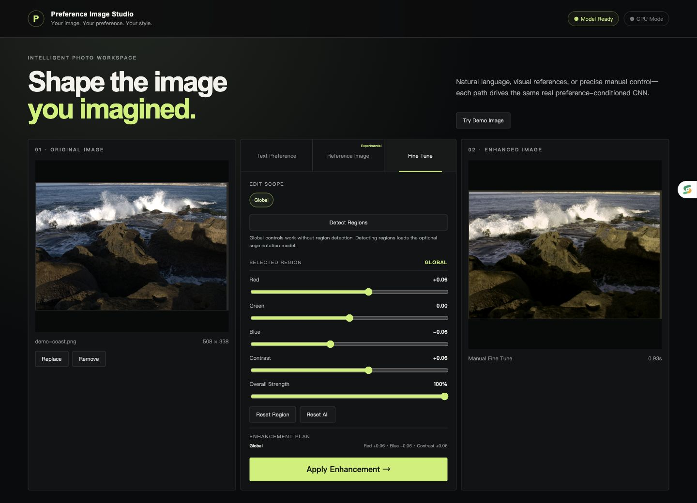
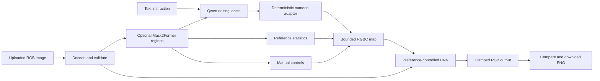

# Preference Image Studio

[](https://github.com/MakenzieAhern/preference-image-studio/actions/workflows/ci.yml)


**An image enhancement workspace that turns words, reference photos, and manual adjustments into spatial controls for a trained CNN.**

Upload a photo, choose how to express the intended edit, compare the result, and download a PNG. The React interface and FastAPI service make the same inference pipeline accessible through three control modes, with optional semantic regions for more targeted adjustments.



*Actual application capture. Global controls: red +0.06, blue −0.06, contrast +0.06. This is an example output, not an image-quality benchmark.*

## What it does

| Mode | How the edit is constructed | Models needed |
| --- | --- | --- |
| **Fine Tune** | Red, green, blue and contrast sliders create a four-channel control map. | Bundled CNN only |
| **Regional Fine Tune** | Detect semantic regions, select by chip or image click, then combine global and regional adjustments with feathered boundaries. | CNN + Mask2Former |
| **Reference Image** | Transfer robust colour and contrast statistics from a reference of any dimensions; optionally match semantic classes between both images. | CNN; Mask2Former only when semantic matching is enabled |
| **Text Preference** | Segment the image, interpret the instruction as regional editing labels, and convert those labels into bounded numeric controls. | CNN + Mask2Former + Qwen |

The interface includes an editable enhancement plan, text-to-manual handoff, before/after slider, side-by-side comparison, TIFF preview, and PNG download. Global Fine Tune is the default; **Detect Regions** and semantic reference matching explicitly opt into the larger model dependencies.

## Engineering highlights

- **One conditioning contract:** every mode produces a `[4, H, W]` RGBC map, bounded to `[-0.3, 0.3]`, consumed alongside the source RGB image.
- **Inspectable text edits:** the language model selects editing labels; deterministic code performs the numeric conversion. Invalid model responses become errors instead of silently producing an empty edit.
- **Strict checkpoint loading:** the bundled 244,035-parameter CNN loads with `weights_only=True` and strict state matching. Missing or incompatible weights stop startup.
- **Reusable segmentation:** an eight-image cache keyed by source SHA-256 lets regional slider changes reuse masks. Cached regions must match the uploaded source.
- **Robust upload and request handling:** decoded-image validation, EXIF orientation, explicit size limits, finite-value checks, serialized model access, and frontend protection against stale asynchronous results.
- **Repeatable verification:** 79 Python tests, 15 frontend DOM tests, a comparison rendering check, production build, and GitHub Actions. See [test evidence and scope](docs/VERIFICATION.md).

## Run locally

Use **Python 3.12**, **Node.js 22.12 or newer**, and **pnpm 11.25.0**. The tested macOS configuration uses CPU inference; this implementation does not select Apple MPS.

```bash
git clone https://github.com/MakenzieAhern/preference-image-studio.git
cd preference-image-studio
python3.12 -m venv .venv
source .venv/bin/activate
python -m pip install --upgrade pip
python -m pip install -r requirements.txt
npm install --global pnpm@11.25.0
pnpm --dir demo_web/frontend install --frozen-lockfile
```

On Windows, create the environment with `py -3.12 -m venv .venv` and activate it with `.venv\Scripts\Activate.ps1`; the remaining commands are the same. The Windows setup commands are documented but were not revalidated on Windows for this release.

Start the API in one terminal, from the repository root:

```bash
source .venv/bin/activate
python -m uvicorn demo_web.backend.app:app --host 127.0.0.1 --port 8000
```

Start the frontend in another terminal:

```bash
pnpm --dir demo_web/frontend dev
```

Open **[127.0.0.1:5173](http://127.0.0.1:5173)**. Select **Try Demo Image**, keep **Fine Tune → Global**, adjust a slider, and select **Apply Enhancement**. This path works with the bundled checkpoint and does **not** download Mask2Former or Qwen. Stop both terminal processes with `Ctrl+C`.

API documentation: [127.0.0.1:8000/docs](http://127.0.0.1:8000/docs). Health check: [127.0.0.1:8000/api/health](http://127.0.0.1:8000/api/health).

### Optional semantic and text models

**Detect Regions**, semantic reference matching, and text requests download pretrained weights on first use and cache them through Hugging Face. They need substantially more memory, disk space and startup time than global Fine Tune.

- Segmentation: [`facebook/mask2former-swin-large-ade-semantic`](https://huggingface.co/facebook/mask2former-swin-large-ade-semantic).
- Default instruction model: [`Qwen/Qwen2.5-7B-Instruct`](https://huggingface.co/Qwen/Qwen2.5-7B-Instruct). CUDA uses 4-bit NF4 via the optional `bitsandbytes` package; CPU loads float32. **The default 7B CPU profile is unsuitable for an 8GB machine.**
- A smaller Qwen checkpoint can be explicitly selected for development. In this release's smoke checks, **0.5B failed to follow the tested editing instructions reliably**. It is not a validated replacement for the default; see the [actual text-mode results](docs/VERIFICATION.md).

```bash
# Example: explicitly select the smaller development model before starting the API.
export PIE_LLM_MODEL=Qwen/Qwen2.5-0.5B-Instruct
python -m uvicorn demo_web.backend.app:app --host 127.0.0.1 --port 8000
```

PowerShell equivalent: `$env:PIE_LLM_MODEL = "Qwen/Qwen2.5-0.5B-Instruct"`.

| Environment variable | Purpose |
| --- | --- |
| `PIE_LLM_MODEL` | Qwen-compatible Hugging Face model ID or local model directory; default is 7B above. |
| `PIE_SEGMENTATION_MODEL_PATH` | Local copy of the same Mask2Former ADE20K checkpoint; its label mapping is validated. |
| `PIE_MODEL_LOCAL_FILES_ONLY=1` | Require models to exist locally; prevent model downloads. |
| `HF_HOME` | Standard Hugging Face cache location. |
| `PIE_DEBUG_LLM=1` | Print generated model text for local debugging; off by default. |

For CUDA text inference, install `bitsandbytes` separately in a supported CUDA environment. The published CI tests use CPU wheels, and CUDA/4-bit execution is not part of this release's verified hardware matrix.

## How it works



The CNN concatenates three image channels and four control channels. A 7→64 convolution, three residual blocks, two global-context branches, and a 64→3 output convolution predict an RGB residual. The final image is `clamp(source + residual, 0, 1)`.

Reference mode measures trimmed median RGB and the luminance P90–P10 span. Optional region matching applies the same calculation to shared semantic classes covering at least 0.5% of each image and 32 pixels; unmatched source regions retain the global adjustment. This is **experimental statistical transfer**, not a reference-image encoder or general neural style-transfer model.

Manual regional adjustments use a two-pixel Gaussian feather. The model's convolutions and global context can affect neighbouring pixels, so regional controls do not promise strict pixel isolation. Zero controls or zero strength also do not guarantee identity: the CNN still predicts its learned residual.

## Test and build

```bash
python -m pip install -r requirements-dev.txt
python -m pytest --cov --cov-report=term
pnpm --dir demo_web/frontend test
pnpm --dir demo_web/frontend test:compare
pnpm --dir demo_web/frontend build
```

The default suites are offline: they exercise the **real bundled CNN**, while optional segmentation and language-model calls use explicitly controlled test doubles. Real optional-model smoke checks are recorded separately in [verification](docs/VERIFICATION.md); their results must not be inferred from unit-test counts.

## Project layout

```text
demo_web/
  frontend/src/             React workspace, comparison UI and DOM tests
  backend/
    app.py                  FastAPI endpoints and upload validation
    inference_service.py    Shared inference, output metadata and mask cache
    preference_adapter.py   Manual/regional/text control construction
    reference_adapter.py    Explainable reference statistics
    model/                  CNN architecture and bundled checkpoint
    z3_use/                 Lazy segmentation, language model and map conversion
tests/                      Backend regression and API tests
docs/                       Verification, provenance and real UI captures
.github/workflows/ci.yml     CPU backend and frontend checks
```

## API and operational limits

| Endpoint | Purpose |
| --- | --- |
| `GET /api/health` | Checkpoint/device readiness |
| `POST /api/preview` | Convert an uploaded image to browser-compatible preview |
| `POST /api/segment` | Cache semantic masks and return region overlays |
| `GET /api/segment/{id}/region?x=&y=` | Resolve a clicked source pixel to its cached region |
| `POST /api/enhance/manual` | Global RGBC controls |
| `POST /api/enhance/manual-regions` | Cached region controls plus global settings |
| `POST /api/enhance/reference` | Global or semantic reference transfer |
| `POST /api/enhance/text` | Natural-language preference |

Uploads accept single-frame PNG, JPEG or TIFF, up to **20 MiB** and **4 million pixels**. Text preferences are limited to 2,000 characters. Very large images can still exhaust a small machine's memory; use the included 508×338 example for a lightweight first run.

This is a **local research demo**. Uploaded sources are processed in temporary directories; generated images, previews and mask overlays persist in `demo_web/outputs/` until removed. They are excluded from Git. The service has no authentication, tenant isolation or automatic output expiry; keep it bound to loopback. The app sends no images to hosted inference services, although initial model downloads contact Hugging Face.

The bundled checkpoint does not contain enough training provenance to reproduce training or substantiate PSNR/SSIM or preference-quality claims. Evaluation here concerns working software, valid conditioning, and reproducible inference paths.

## Author and provenance

**Yuchen Deng** independently implemented this Web project, including the frontend, backend, model integration and enhancement algorithms. Mask2Former and Qwen are third-party pretrained models and are credited above.

This portfolio edition was extracted from the requested `feature/final-web-demo` branch and retains its CNN checkpoint. It adds portability fixes, regression coverage, CI and documentation. Source revision, asset provenance and checkpoint checksum are recorded in [PROVENANCE.md](docs/PROVENANCE.md). Third-party models and sample assets retain their respective terms; this snapshot does not assign a blanket license to them.
